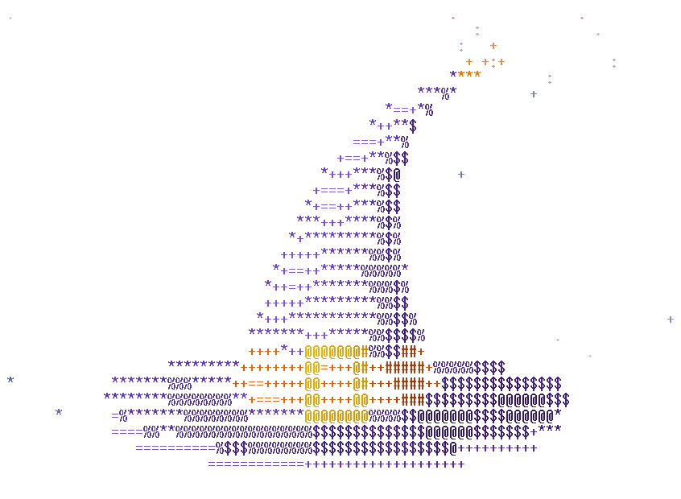

# Hey there!

<picture>
  <source media="(prefers-color-scheme: dark)" srcset="witch-hat-dark.gif">
  
</picture>

I'm a web developer focused on software architecture. Most of my work consists
of making ugly decisions look readable and making sure that old software
doesn't collapse on itself.

I have experience with mobile development, cloud architecture and shipping
products from their conception all the way to the clients. Favorite tooling:
TypeScript, React, NestJS, Expo.

Sometimes I write [blog posts](https://nocnitsa.com/).

~ [_nocnitsa.com_](https://nocnitsa.com/)
